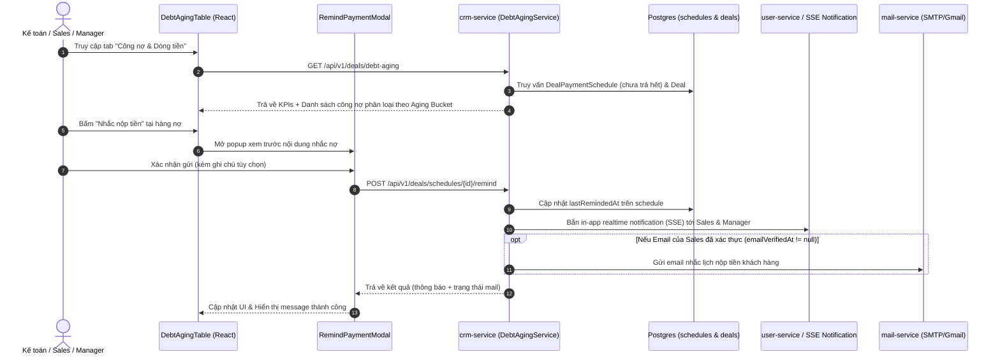

# Technical Design Spec: Quản Lý Công Nợ & Cảnh Báo Nhắc Nộp Tiền (Debt Aging & Payment Reminder)

## 1. Mục Tiêu Nghiệp Vụ
- **Bài toán**: Sau khi ký hợp đồng và cọc xong, Sales và Kế toán không nắm được khách hàng nào sắp đến hạn nộp tiền đợt 2, 3... dẫn đến tình trạng chậm trễ dòng tiền dự án, quá hạn khó thu hồi.
- **Giải pháp**:
  1. **Dashboard Dòng Tiền & Công Nợ**: Cung cấp cái nhìn tổng quan về dòng tiền dự kiến thu theo tháng, thực tế đã thu, và phân loại công nợ theo tuổi nợ (Debt Aging Buckets: $\le 7$ ngày, 1-30 ngày, 31-60 ngày, >60 ngày).
  2. **Cảnh Báo & Nhắc Nợ 1 Chạm (One-Click Reminder)**: Cho phép Kế toán/Sales kích hoạt nhắc nộp tiền tức thì. Hệ thống đồng thời phát thông báo in-app (realtime SSE) và gửi email nhắc việc chi tiết cho Sales phụ trách (với điều kiện tài khoản đã xác thực email `emailVerifiedAt != null`).

---

## 2. Kiến Trúc & Luồng Dữ Liệu



---

## 3. Quy Tắc Phân Loại Tuổi Nợ (Debt Aging Logic)

Dựa trên số ngày giữa ngày đến hạn (`dueDate`) và thời điểm hiện tại (`today`):
1. **`DUE_SOON` (Sắp đến hạn)**: `dueDate >= today && dueDate <= today + 7` (Còn từ 0 đến 7 ngày). Badge màu Vàng/Amber.
2. **`OVERDUE_1_30` (Quá hạn 1 - 30 ngày)**: `dueDate < today && daysLate <= 30`. Badge màu Cam/Orange.
3. **`OVERDUE_31_60` (Quá hạn 31 - 60 ngày)**: `daysLate >= 31 && daysLate <= 60`. Badge màu Đỏ/Red.
4. **`OVERDUE_60_PLUS` (Quá hạn nghiêm trọng > 60 ngày)**: `daysLate > 60`. Badge màu Tím đậm/Purple.

---

## 4. Đặc Tả DTOs & API Contracts

### 4.1. `GET /api/v1/deals/debt-aging`
**Response Payload (`DebtAgingSummaryResponse`)**:
```json
{
  "totalReceivable": 14250000000,
  "collectedThisMonth": 2450000000,
  "expectedThisMonth": 5100000000,
  "dueSoonAmount": 1575000000,
  "overdueAmount": 1050000000,
  "overdueCount": 3,
  "items": [
    {
      "scheduleId": "sch-002",
      "dealId": "deal-001",
      "contractCode": "HD-20261018-1024",
      "customerId": "c-001",
      "customerName": "Trần Đình Trọng",
      "customerPhone": "0905123456",
      "productCode": "RL-A201",
      "projectName": "Regal Legend Quảng Bình",
      "salesId": "u-001",
      "salesName": "Trần Quản Lý",
      "installmentNo": 2,
      "installmentName": "Đợt 2: Ký HĐMB (Đủ 15% gồm cọc)",
      "amountDue": 425000000,
      "amountPaid": 0,
      "amountRemaining": 425000000,
      "dueDate": "2026-10-25",
      "daysDiff": 7,
      "agingBucket": "DUE_SOON",
      "lastRemindedAt": null
    }
  ]
}
```

### 4.2. `POST /api/v1/deals/schedules/{scheduleId}/remind`
**Request Payload (`RemindPaymentRequest`)**:
```json
{
  "note": "Khách hẹn chiều 25/10 chuyển khoản Vietcombank"
}
```

**Response Payload (`RemindPaymentResponse`)**:
```json
{
  "success": true,
  "scheduleId": "sch-002",
  "salesName": "Trần Quản Lý",
  "salesEmail": "manager.demo@dxmt.vn",
  "emailSent": true,
  "inAppSent": true,
  "message": "Đã gửi thông báo in-app và email nhắc nộp tiền thành công"
}
```

---

## 5. Thiết Kế Giao Diện Frontend (Ant Design v5 + Design Tokens)
1. **Tabs Điều Hướng**: Thêm tab `"Công Nợ & Dòng Tiền"` trong trang Deals (`DealsPage.tsx`) hoặc mở rộng thành trang phân tích dòng tiền chuyên sâu.
2. **4 KPI Cards**:
   - Tổng công nợ toàn hệ thống (Viền xanh navy, biểu tượng tiền tệ).
   - Đã thu trong tháng (Viền xanh ngọc emerald, thanh tiến độ % so với kế hoạch).
   - Nợ sắp đến hạn $\le 7$ ngày (Viền hổ phách amber, số lượng đợt).
   - Nợ quá hạn (Viền đỏ rose/đỏ ruby, đếm số hợp đồng quá hạn).
3. **Bộ lọc danh sách nợ**:
   - Tất cả / Sắp đến hạn / Quá hạn 1-30 ngày / Quá hạn >30 ngày / Theo dự án / Theo sales.
4. **Nút "Nhắc nộp tiền" & Modal xem trước**:
   - Hiển thị mẫu thư gửi Sales và Khách: Tên căn, số tiền, ngày hạn, STK CĐT Đất Xanh Miền Trung / Regal Group, ô nhập ghi chú bổ sung.

---

## 6. Kế Hoạch Kiểm Thử
- **Backend Unit Tests**:
  - Test thuật toán phân loại Aging Bucket (DUE_SOON, OVERDUE 1-30, 31-60, >60).
  - Test API endpoint `/deals/debt-aging` và `/deals/schedules/{id}/remind`.
- **Frontend Typecheck**: TypeScript strict mode pass 100%.
- **Playwright E2E Audit**:
  - Mở tab Công nợ & Dòng tiền.
  - Kiểm tra 4 thẻ KPI render chính xác.
  - Lọc nợ sắp đến hạn và quá hạn.
  - Bấm "Nhắc nộp tiền", nhập ghi chú, gửi thành công và kiểm tra cập nhật trạng thái `lastRemindedAt`.
