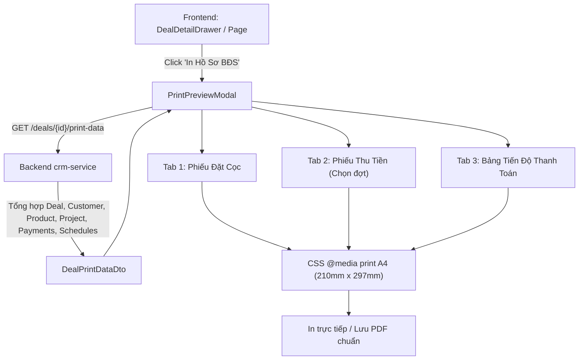

# Design Document: Xuất Hồ Sơ & Văn Bản BĐS Tự Động (Real Estate Document & PDF Generator)

- **Ngày ban hành**: 2026-10-18
- **Phiên bản**: 1.0.0
- **Trạng thái**: Đã phê duyệt (Approved)
- **Hệ thống áp dụng**: `CRM_Estate_System` (Backend `crm-service`) & `FE_Estate_System` (Frontend React)

---

## 1. Bối Cảnh & Mục Tiêu

Trong quy trình bán hàng bất động sản tại Đất Xanh Miền Trung / Regal Group:
1. Khi khách hàng chốt căn và đặt cọc, Sales và Ban Thư ký bán hàng phải mất từ 15-30 phút để soạn thủ công văn bản Word: **Phiếu Đăng Ký Đặt Cọc Căn Hộ**, **Biên Lai Thu Tiền Cọc**, và **Bảng Tiến Độ Thanh Toán**.
2. Thao tác thủ công dễ dẫn đến sai sót: nhầm số tiền, nhầm diện tích, sai mã căn hộ, hoặc thông tin cá nhân khách hàng không khớp với dữ liệu CRM.
3. **Mục tiêu**: Tự động hóa 100% việc sinh văn bản BĐS từ dữ liệu số trong hệ thống. Một click là có thể xem trước mẫu in chuẩn A4, in trực tiếp qua máy in văn phòng, hoặc xuất file PDF gửi ngay cho khách hàng qua Zalo/Email.

---

## 2. Các Mẫu Biểu Tiêu Chuẩn

Hệ thống hỗ trợ 3 mẫu văn bản hành chính BĐS:

### Mẫu 1: Phiếu Đăng Ký Đặt Cọc Căn Hộ (Deposit Agreement Form)
- Quốc hiệu & Tiêu ngữ chuẩn Việt Nam.
- **Bên Bán (Chủ Đầu Tư)**: Tổng Công ty Đất Xanh Miền Trung / Regal Group, MST, Địa chỉ, Đại diện ủy quyền, Hotline.
- **Bên Mua (Khách Hàng)**: Họ tên, Số CCCD/CMND, Ngày cấp, Nơi cấp, Địa chỉ thường trú, SĐT liên hệ.
- **Thông Tin Bất Động Sản**: Dự án, Mã căn (Unit Code), Block, Tầng, Diện tích tim tường, Diện tích thông thủy, Hướng căn hộ.
- **Thỏa Thuận Tài Chính**: Giá niêm yết (gồm/chưa gồm VAT), Số tiền đặt cọc (bằng số & bằng chữ), Thời hạn nộp đợt 1 và ngày hẹn ký HĐMB chính thức.
- **Cam kết & Chữ ký**: Chữ ký bên Mua, Chữ ký Chuyên viên tư vấn (Sales), Chữ ký & Con dấu xác nhận của Đại diện CĐT.

### Mẫu 2: Biên Lai / Phiếu Thu Tiền Từng Đợt (Payment Receipt)
- Số phiếu thu, ngày lập, quyển số.
- Đơn vị thu tiền: Phòng Kế toán / Thủ quỹ CĐT.
- Người nộp tiền: Họ tên khách hàng, SĐT, Mã căn hộ.
- Lý do nộp tiền: Ghi rõ nội dung (VD: "Thanh toán Đợt 2 ký HĐMB - Căn hộ RL-A201 Dự án Regal Legend").
- Số tiền nộp: Định dạng tiền tệ VNĐ chuẩn và diễn giải bằng chữ.
- Phương thức thanh toán: Tiền mặt hoặc Chuyển khoản (kèm số tài khoản thụ hưởng, ngân hàng).
- **Watermark & Bảo mật**: Con dấu "ĐÃ THU TIỀN" (PAID) màu xanh lá/đỏ in chìm.
- **Mã QR Code**: Mã QR tra cứu thông tin hợp đồng và mã biên lai chống giả mạo.

### Mẫu 3: Bảng Kế Hoạch & Tiến Độ Thanh Toán (Payment Schedule Sheet)
- Bảng tổng hợp chi tiết toàn bộ các đợt thanh toán từ Đợt 1 đến Đợt 7.
- Cột dữ liệu: Số đợt, Tên đợt, Tỷ lệ %, Ngày đến hạn nộp, Số tiền phải nộp, Số tiền đã thu thực tế, Trạng thái đợt.
- Ghi chú điều khoản lãi chậm nộp theo quy định của Chủ đầu tư.

---

## 3. Kiến Trúc Kỹ Thuật

### 3.1 Backend `crm-service`
- **Controller**: `DealDocumentController` (`/api/v1/deals/{id}/print-data`).
- **Service**: `DealDocumentService.getPrintData(UUID dealId)`.
- **DTOs**: `DealPrintDataResponse`, `CompanyLegalInfo` (Thông tin CĐT Đất Xanh Miền Trung).

### 3.2 Frontend `FE_Estate_System`
- Module: `src/features/documents/`
  - `api.ts`: API client & React Query hook `useDealPrintData(dealId)`.
  - `components/PrintPreviewModal.tsx`: Modal chứa preview với tỷ lệ A4 chuẩn.
  - `components/templates/DepositAgreementTemplate.tsx`: Mẫu phiếu cọc.
  - `components/templates/PaymentReceiptTemplate.tsx`: Mẫu phiếu thu tiền.
  - `components/templates/PaymentScheduleTemplate.tsx`: Mẫu tiến độ nộp tiền.
  - `styles/document-print.css`: CSS tối ưu in ấn khổ giấy A4, ẩn header/footer trình duyệt, ngắt trang chuẩn xác.

---

## 4. Kịch Bản Kiểm Thử & Nghiệm Thu
1. Mở Modal chi tiết Hợp đồng HD-20261018-1024 $\rightarrow$ Bấm nút "In hồ sơ & Phiếu cọc".
2. Xem trước Phiếu đặt cọc: đầy đủ thông tin khách hàng Trần Đình Trọng, căn hộ RL-A201, số tiền cọc 100.000.000 đ (Một trăm triệu đồng chẵn).
3. Chuyển sang Tab "Phiếu thu tiền": Chọn đợt thanh toán $\rightarrow$ Hiển thị phiếu thu với mã QR và con dấu chìm "ĐÃ THU TIỀN".
4. Chuyển sang Tab "Bảng tiến độ nộp tiền": Bảng kê 7 đợt thanh toán hiển thị rõ ràng.
5. Thao tác In (`window.print`) kích hoạt giao diện máy in của trình duyệt định dạng đúng chuẩn A4 dọc.
