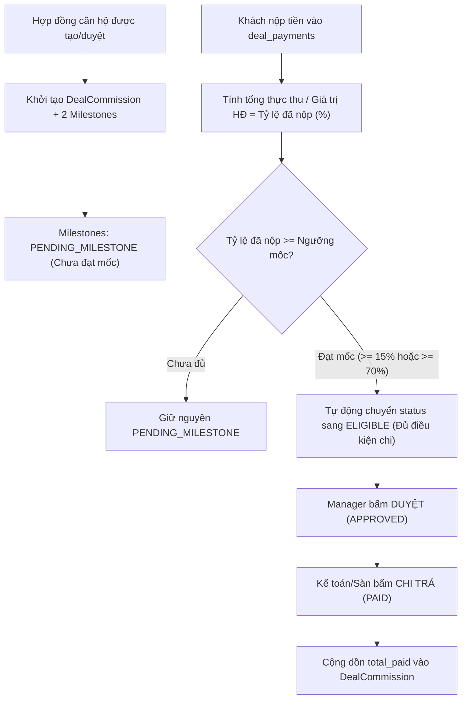

# Technical Design Spec: Sales Commission & Incentive Engine (Giai Đoạn 5)

## 1. Mục Tiêu & Bối Cảnh Nghiệp Vụ
Sau khi hoàn tất 4 giai đoạn cốt lõi (Chăm sóc KH -> Khóa căn -> Bảng hàng ma trận -> Tiến độ thanh toán căn hộ), hệ thống cần tính toán **Hoa hồng & Thưởng Doanh số Sales** nhằm:
1. **Gắn liền với tiền thực thu**: Hoa hồng không chi trả 100% khi khách mới cọc, mà giải ngân theo mốc tiền khách hàng thực nộp (tích hợp dữ liệu `deal_payments` và `deal_payment_schedules` từ Giai đoạn 4).
2. **Minh bạch cho Sales**: Sales chủ động theo dõi bảng kê hoa hồng từng căn đã bán, biết chính xác số tiền hoa hồng dự kiến, số tiền đã đủ điều kiện nhận, và số tiền đã chi trả.
3. **Kiểm soát cho Manager / Sàn**: Quản lý thiết lập chính sách % hoa hồng theo Dự án và duyệt chi hoa hồng khi khách hàng đạt đủ tỷ lệ thanh toán cam kết.

---

## 2. Kiến Trúc Dữ Liệu (`CRM_DB` - `crm-service`)

### 2.1 Bảng `project_commission_policies` (Chính sách hoa hồng dự án)
| Cột | Kiểu | Mô tả |
|---|---|---|
| `id` | `UUID` (PK) | Định danh chính sách |
| `project_id` | `UUID` (Unique) | Dự án áp dụng |
| `commission_rate` | `DECIMAL(5,2)` | Tỷ lệ hoa hồng chuẩn (VD: `2.50` cho 2.5%) |
| `default_bonus_amount` | `DECIMAL(15,2)` | Thưởng nóng mặc định cho mỗi căn (VD: 10.000.000 đ) |
| `milestone_rules` | `TEXT` (JSON) | Quy tắc giải ngân mốc (ngưỡng khách nộp & % hoa hồng giải ngân) |
| `created_at`, `updated_at` | `TIMESTAMP` | Thời gian tạo và cập nhật |

*Cấu trúc JSON `milestone_rules` chuẩn BĐS:*
```json
[
  { "milestoneNo": 1, "name": "Đợt 1: Đủ 15% HĐMB", "customerPaidThresholdPct": 15.0, "payoutPercentage": 50.0 },
  { "milestoneNo": 2, "name": "Đợt 2: Đủ 70% nhận nhà", "customerPaidThresholdPct": 70.0, "payoutPercentage": 50.0 }
]
```

### 2.2 Bảng `deal_commissions` (Bản ghi hoa hồng hợp đồng)
| Cột | Kiểu | Mô tả |
|---|---|---|
| `id` | `UUID` (PK) | Định danh hoa hồng hợp đồng |
| `deal_id` | `UUID` (Unique) | FK tham chiếu `deals(id)` |
| `sales_id` | `UUID` | FK tham chiếu nhân viên Sales phụ trách hợp đồng |
| `contract_value` | `DECIMAL(15,2)` | Giá trị hợp đồng (căn hộ) |
| `commission_rate` | `DECIMAL(5,2)` | Tỷ lệ hoa hồng áp dụng (%) |
| `commission_amount` | `DECIMAL(15,2)` | Tiền hoa hồng cơ bản = `contract_value * rate / 100` |
| `bonus_amount` | `DECIMAL(15,2)` | Tiền thưởng nóng bổ sung cho căn hộ |
| `total_expected` | `DECIMAL(15,2)` | Tổng hoa hồng dự kiến = `commission_amount + bonus_amount` |
| `total_paid` | `DECIMAL(15,2)` | Tổng tiền hoa hồng thực tế đã chi trả cho Sales |
| `status` | `VARCHAR(30)` | `PENDING`, `PARTIALLY_PAID`, `FULLY_PAID`, `CANCELLED` |
| `created_at`, `updated_at` | `TIMESTAMP` | Thời gian tạo và cập nhật |

### 2.3 Bảng `deal_commission_milestones` (Các đợt giải ngân hoa hồng)
| Cột | Kiểu | Mô tả |
|---|---|---|
| `id` | `UUID` (PK) | Định danh đợt giải ngân hoa hồng |
| `deal_commission_id` | `UUID` | FK tham chiếu `deal_commissions(id)` |
| `milestone_no` | `INT` | Thứ tự đợt (1, 2) |
| `name` | `VARCHAR(255)` | Tên mốc giải ngân (VD: Đợt 1 - Đủ 15% HĐMB) |
| `customer_paid_threshold_pct` | `DECIMAL(5,2)` | Ngưỡng khách cần nộp để mở khóa (VD: 15.0%) |
| `payout_percentage` | `DECIMAL(5,2)` | Tỷ lệ hoa hồng được giải ngân ở đợt này (VD: 50.0%) |
| `amount_expected` | `DECIMAL(15,2)` | Số tiền hoa hồng đợt này = `total_expected * payoutPercentage / 100` |
| `amount_paid` | `DECIMAL(15,2)` | Số tiền đã thực chi |
| `status` | `VARCHAR(30)` | `PENDING_MILESTONE`, `ELIGIBLE`, `APPROVED`, `PAID` |
| `approved_by` | `UUID` | Manager phê duyệt chi |
| `approved_at` | `TIMESTAMP` | Thời điểm phê duyệt |
| `paid_at` | `TIMESTAMP` | Thời điểm kế toán/sàn chi trả tiền |
| `note` | `TEXT` | Ghi chú chứng từ chi |
| `created_at`, `updated_at` | `TIMESTAMP` | Thời gian tạo và cập nhật |

---

## 3. Quy Trình Vận Hành & Thuật Toán Tự Động Kích Hoạt (Milestone Engine)



---

## 4. REST API Endpoints (`crm-service`)

### 4.1 Quản lý Hoa hồng
- `GET /api/v1/commissions/my`: Sales xem danh sách hoa hồng cá nhân + thống kê 4 thẻ KPI.
- `GET /api/v1/commissions`: Manager/Admin xem danh sách hoa hồng toàn bộ Sales, lọc theo Dự án/Trạng thái mốc.
- `GET /api/v1/deals/{dealId}/commission`: Xem chi tiết hoa hồng và các đợt giải ngân của 1 hợp đồng.
- `POST /api/v1/commissions/milestones/{id}/approve`: Manager duyệt đợt hoa hồng (`ELIGIBLE` -> `APPROVED`).
- `POST /api/v1/commissions/milestones/{id}/payout`: Sàn ghi nhận đã chi trả cho Sales (`APPROVED` -> `PAID`).

### 4.2 Chính sách Hoa hồng Dự án
- `GET /api/v1/projects/{projectId}/commission-policy`: Lấy chính sách hoa hồng hiện tại của dự án.
- `PUT /api/v1/projects/{projectId}/commission-policy`: Cấu hình / cập nhật chính sách (% hoa hồng, thưởng nóng, mốc giải ngân).

---

## 5. Thiết Kế Giao Diện Frontend (`FE_Estate_System`)

1. **Menu Sidebar**:
   - Thêm mục `Hoa hồng & Thưởng` (`/commissions`) dưới menu `BÁN HÀNG`.
2. **Trang `/commissions` (CommissionsPage)**:
   - **Thanh 4 KPI**:
     - *Tổng hoa hồng kỳ vọng*: Tổng số tiền hoa hồng tất cả hợp đồng đã chốt.
     - *Đã thực nhận*: Tiền hoa hồng kế toán đã chi trả (`PAID`).
     - *Đủ điều kiện giải ngân*: Các mốc khách đã đóng đủ tiền, đang chờ duyệt/chờ chi (`ELIGIBLE` / `APPROVED`).
     - *Chờ tiến độ khách*: Các mốc chưa đến hạn nộp tiền của khách (`PENDING_MILESTONE`).
   - **Tab 1: Hoa hồng của tôi (Sales View)**:
     - Bảng chi tiết từng hợp đồng căn hộ, tiến độ đóng tiền khách, thanh tiến độ giải ngân hoa hồng, trạng thái từng đợt (Tag: Xanh lá `Đã chi`, Cam `Đủ điều kiện`, Vàng `Đã duyệt`, Xám `Chưa đạt mốc`).
   - **Tab 2: Phê duyệt & Chi trả (Manager/Admin View)**:
     - Bộ lọc tìm kiếm nhanh các mốc đang ở trạng thái `ELIGIBLE` để Manager duyệt 1 chạm.
   - **Tab 3: Chính sách dự án (Manager View)**:
     - Form cấu hình % hoa hồng và các mốc thanh toán cho từng Dự án.
3. **Tích hợp vào DealDetailModal**:
   - Thêm khối "Hoa hồng & Thưởng Sales" ngay trong cửa sổ chi tiết hợp đồng để Sales và Quản lý theo dõi trực tiếp.

---

## 6. Kế Hoạch Kiểm Thử Toàn Diện (Playwright E2E)
- Kịch bản tự động hóa 5 bước:
  1. Mở trang `/commissions` -> Xác nhận 4 thẻ KPIs và danh sách hợp đồng căn hộ.
  2. Xem chi tiết mốc hoa hồng hợp đồng -> Mốc 1 hiển thị `PENDING_MILESTONE` khi khách chưa đóng đủ tiền.
  3. Khách hàng đóng đủ tiền đợt 2 (>= 15%) -> Hệ thống tự động chuyển Mốc 1 sang `ELIGIBLE` (Đủ điều kiện giải ngân).
  4. Manager thực hiện duyệt mốc -> Chuyển trạng thái sang `APPROVED`.
  5. Kế toán xác nhận chi trả -> Chuyển sang `PAID`, số tiền được cộng dồn vào KPI "Đã thực nhận" của Sales.
